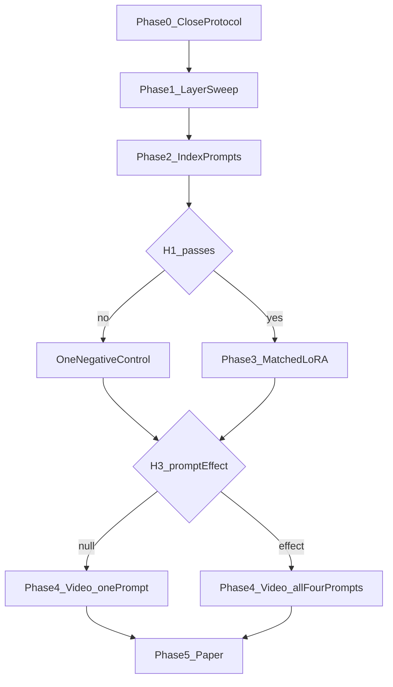

# Phases and branches

Sequenced on 5 November 2026. The pass/fail rules are in [study-protocol.md](study-protocol.md). This file says which experiment runs next, and which ideas stay out of the paper. No phase has been started. US-001 and US-002 are the only finished stories.

## Phase 0 — name the backbone (US-007)

The dataset choices are already written in the protocol. The remaining step is a one-batch check, in this order: Qwen2.5-VL-3B, then Qwen3-VL-2B, then Llama-Nemotron-Embed-VL-1B-v2. Keep the first checkpoint whose forward pass returns every language-trunk hidden state. Record whether it is a raw vision-language model or an already-trained embedder. If none of the three expose layers, the study stops. The paper does not describe a sweep that did not happen.

That check has not been run.

## Phase 1 — training-free readout (US-003)

One forward per dev example, all layers kept. Two poolings: mean over trunk tokens, and last token. PCA whitening is fit on the dev vectors, per layer. Rank by dev text-to-photo Recall@10 under the empty index prefix. Freeze pooling and layer, then score H1 on the held-out photo split and score the SciFact text control with the same vectors. The paper reports the full layer curve.

## Phase 2 — index prompts (US-004)

Always runs after Phase 1. Four prefixes, all reported, at the chosen layer and at the final layer only. The query prefix stays fixed. One extra cell drops the query prefix and is not used to choose a prompt or a layer. A null result does not reopen the layer choice.

## Phase 3 — training branch (US-005)

- **H1 fails.** One run: a projection head on the frozen trunk, at the best weak layer. Then training stops. The paper's claim is that a short trunk does not keep the joint space.
- **H1 passes.** Three matched runs on the same public image-text pairs, for the same steps and the same seed budget. The vision encoder stays frozen. The runs are cut-trunk LoRA, full-depth LoRA, and the frozen-head control. H2 passes if the cut trunk is within 5 Recall@10 of the full-depth run. One seed decides the gate. Three seeds are used only for the table in the paper. A released small vision-language embedder is scored once as a ceiling, not as a target.

Neither branch trains on video.

## Phase 4 — video transfer (US-008)

Always runs, on the checkpoint the study kept: the chosen layer if H1 passed, otherwise the final layer. Eight frames, mean-pooled, no video training. Chance Recall@10 is stated from the MSR-VTT pool size.

- **H3 null on photos.** Score video with the empty index prefix only.
- **H3 shows a prompt effect.** Score video under all four prefixes. That is the only extra video work.

## Phase 5 — paper (US-006)

Write the branch that ran, in this order: the H1 curve, the prompt table, training only if the gate opened, then video transfer. A failed cut or a null prompt effect is the finding. Related work follows [../findings/literature-review.md](../findings/literature-review.md) and does not add new claims.

## Not this paper

These can be one sentence in the discussion. They are not experiments in this study.

- A second backbone, and only as a replication after this paper's branch is finished. Trying models until one passes H1 is not allowed.
- Score distillation of the kind MM-Matryoshka used, if H1 fails.
- Text-video contrastive training, or a temporal encoder, if H4 fails or if a later paper wants a trained video model.
- A full crossing of query prefixes and index prefixes, if H3 is non-null. This study drops the query prefix in one cell only.
- Matryoshka widths, int8 weights, and a serving stack.
